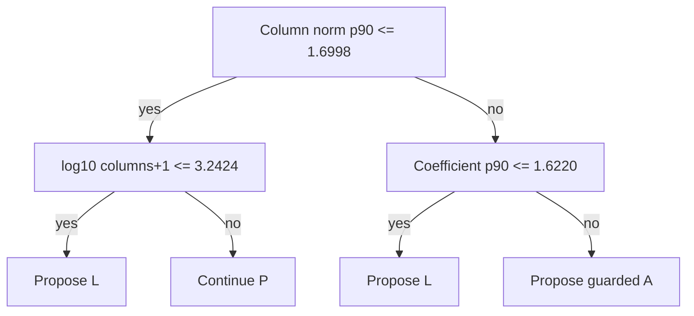

# One 200-iteration PC pilot and a small scaling model — 2026-10-03

This experiment preserves the existing opt-in two-pilot selector, production
scaling defaults and `verifyKkt`. Its separate study driver starts with PC-only
(P), observes its first 200 iterations, and uses a depth-two decision tree to
choose P, Ruiz+PC (L), or guarded CR+Ruiz+PC (A). Keeping P continues the same
solver state. A switch discards the pilot and starts a fresh candidate state;
cross-scaling warm starts are not used.

The prototype does **not** improve aggregate elapsed time on the measured
large-CUDA workload. It takes 2.78% more time than fixed P in the primary
nine-instance run and 3.39% more in the serial repeat, with both solving 9/9.
The learned tree proposes P on all nine and uses only three static features;
its five extra host observations add cost without changing the scaling.
Keep production defaults unchanged and retain this as a study tool.

## Pilot and timing boundary

An internal `SolveContext::pilot_observer` hook samples original-coordinate
candidates at 40, 80, 120, 160 and 200 iterations. It performs no extra work
when unset. Ordinary convergence, certificates, iteration and time limits
retain precedence. The normal convergence and restart rules remain in place;
observations do not replace anchors or restart history.

Collected inputs comprise sampled coefficient quantiles, full row/column norm
and degree distributions, row/column bound types, cost/RHS/bound scales,
original-model primal/dual residuals and objective gap, primal/dual norms,
fixed-point error, restart counts and progress changes. The coefficient sample
is deterministic and bounded at 8192 values; norms scan all original nonzeros.
All five extra original-model KKT evaluations, candidate downloads, feature
extraction, model loading/inference, and any cold switch are inside the
reported solver wall time. Input reading and the additional final
external KKT check are recorded separately.

The pilot's measured seconds per iteration converts the leaf's predicted
iteration saving into an estimated time saving. This is a surrogate estimate,
not a model trained on serial CUDA convergence times. The runtime gate requires
estimated savings to exceed 1.5 times the already elapsed pilot plus feature
cost and an estimated fresh setup. The latter is two times measured P setup
for L and four times for A, a conservative heuristic rather than a guaranteed
bound. Setup comprises preprocessing, backend creation and operator norm
estimation. Actual candidate setup and the discarded 200 iterations are fully
charged to the global budget and measured time.

## Model and family split

Only 89 original-sample instances have a verified P/L/A convergence triple in
`cpu_all.csv`, `cpu_long.csv` and `cpu_patched.csv` (the later rows replace earlier
records). Timeout elapsed times are never successful labels. Excluding every
family in the 26 external held-out names and twenty-large-LP set leaves 65
instances. A name-only SHA256 family split reserves 13 instances for validation
and trains on 52 instances from 36 name-derived family groups. Numbered sizes, B/filtered aliases
and known shared prefixes are grouped conservatively. The complete mapping,
excluded names and source labels are retained in `data/2026-10-03-onepilot/`.
This grouping cannot guarantee that undocumented benchmark families are
independent.

The tree has at most depth two, minimum leaf support eight and at least three
families per switching leaf. Training minimizes absolute iteration losses
with a 3x penalty on regression, adding 200 iterations to every switched label.
Leaves must predict at least 25% savings after that penalty and have no more
than 20% training regressions. These thresholds were fixed before validation.
The final runtime gate also estimates fresh setup costs; the tree and its
thresholds were not tuned on CUDA outcomes.

Although all 93 candidate features are available, the tree chooses only
`col_norm_p90`, `cols`, and `a_p90`. Retraining with only static inputs produces
the same validation decisions and thresholds. Thus this tree provides no
evidence that pilot progress improves selection. Pilot work is preserved when
P is retained, but its extra host observations still cost elapsed time.

The tree proposes a candidate as follows; every L/A proposal still passes
through the measured runtime-cost gate, otherwise the same P state continues.
All threshold inputs below are log10 values.



## CPU iteration validation

CPU runs use the serial deterministic backend within each solve, fixed steps,
original LPs without presolve, and both tolerances at 1e-4. Multiple independent
CPU runs execute concurrently; their elapsed times are not policy comparisons.

| Policy | 13 family validation solves | Total iterations | 26 external held-out solves | Total iterations on 23 common solves |
|---|---:|---:|---:|---:|
| PC-only (P) | 13/13 | 7,706,800 | 23/26 | 112,240 |
| Ruiz+PC (L) | 13/13 | 2,511,160 | 23/26 | 105,960 |
| guarded auto (A) | 13/13 | 1,005,760 | 23/26 | 106,680 |
| one-pilot tree (M) | 13/13 | 1,936,920 | 23/26 | 107,800 |

Family validation has a 30-million-iteration budget and a 120-second safety
limit; all policies solve all 13 and there are no time-censored records. M cuts
aggregate iterations 74.87% versus P, but A still uses 48.07% fewer iterations
than M. The gain is dominated by bell5 and share1b; it is not a large-LP
elapsed-time claim. M's worst P regressions are lseu 6.109x, bandm 2.360x and
fit1p 1.498x, despite the training penalty and runtime gate.

The independent 26-name batch uses 500,000 iterations and a 60-second safety
limit. forest6 reaches the iteration limit for all four policies. qap18 and
small_pre hit the time limit for all four and are censored from iteration
comparisons, including PAR2 iteration sums. M cuts the common-solve iteration
sum only 3.96% versus P; its ordinary iteration GM is 564.34 versus P's 578.07,
L's 484.42 and A's 516.78. Seven instances switch, including forest6. The worst
common-solve overhead is qap06lp, 400 P iterations versus 600 for M (1.50x).
The held-out sample includes related QAP/SC formulations and is not a broad
independent-family generalization guarantee.

stair is a separate diagnostic, and belongs to the training sample rather
than the validation split. Fresh fixed-step CPU counts are P 311,440, L
287,400, A 15,600 and M 287,600. The tree selects L: it improves modestly on P
but still takes 18.44 times A's work. The model has not fixed stair's choice.

## Serial CUDA elapsed time

The primary nine-large-LP comparison uses 180 seconds per solve, equal 1e-4
tolerances, fixed steps and a frozen CUDA 12.8 build on the RTX 4070 Ti SUPER.
The tree itself proposes P on all nine; the runtime gate has no L/A proposal
to test. Every M run retains P: there are no scaling switches. It therefore adds pilot
observation work while preserving the useful P iterations.

| Policy | Verified solves | Observed total (s) | PAR2 total (s) |
|---|---:|---:|---:|
| PC-only (P) | 9/9 | 205.184 | 205.184 |
| Ruiz+PC (L) | 9/9 | 231.781 | 231.781 |
| guarded auto (A) | 8/9 | 390.132 | 570.041 |
| one-pilot tree (M) | 9/9 | 210.887 | 210.887 |

M takes **2.78% more aggregate time than P** in the primary run. Its explicit
feature computation costs 4.375 seconds, excluding additional solver-side
candidate download/postsolve work. Inference is only microseconds. The largest
common-solve M/P regressions are savsched1 1.539x and graph40-40 1.353x.
neso-2245 is retained on P: M 96.155 seconds versus P 94.758, L 121.424 and A
126.274. watson_1 solves with M in 28.711 seconds and P in 27.828; A times out.
The eight instances solved by all four policies cost P 177.355, M 182.176,
L 202.447 and A 210.041 seconds.

A free oracle selecting the fastest observed verified P/L/A candidate on each
of these nine costs 201.477 seconds: only 3.707 seconds / 1.81% below fixed P.
The measured feature computation alone exceeds that headroom, before paying
for any cold switch. This comparison is scoped to the measured nine; it does
not assign convergence labels to the previous eleven all-policy timeouts.

Five of the nine have size or coefficient features outside the corresponding
training ranges. The tree maps all nine to its P leaf. These range gaps and the small training
sample limit what its estimates establish about large LPs.

The separate four-large-heldout screen stops at exactly 200 iterations and
measures P with and without the five observations (F). It is a pilot-cost
screen, with no convergence labels:

| Independent held-out | Plain P pilot (s) | Observed P pilot (s) | Ratio |
|---|---:|---:|---:|
| L1_sixm250 | 5.286 | 7.795 | 1.475 |
| istefanov_med | 2.504 | 2.848 | 1.137 |
| support19 | 5.333 | 7.759 | 1.455 |
| square41 | 10.737 | 12.929 | 1.204 |

All stop at the iteration limit without passing KKT. The combined pilot time
rises from 23.860 to 31.331 seconds (+31.31%). Feature extraction itself takes
4.601 seconds; the remainder includes extra candidate downloads/postsolve
and ordinary timing variation. These numbers do not establish convergence
speedups or winning P/L/A labels for the hard instances.

The extended two-instance P/M batch uses 240 seconds per policy. neso-2005
still times out with failed KKT (P 240.891 seconds, M 240.841); cont11 now
passes KKT at P 232.816 seconds and M 232.606. Both policies solve 1/2; M
continues P on both. The subsecond time difference on cont11 is not a scaling
selection gain. These cases had timed out at 180 seconds in the previous
study, illustrating why capped runs cannot supply convergence labels. L/A
have not been measured at this longer budget, so no P/L/A winning label is
assigned, even for the newly solved cont11. The other nine of the previous
eleven all-policy timeouts remain without longer equal-budget measurements.

The serial P/M repeat confirms the result: P **203.148 seconds**, M
**210.035 seconds**, both 9/9 verified, M **3.39% slower**. All nine
again continue P. Worst M/P time regressions in the repeat are savsched1
1.602x and graph40-40 1.351x. No model thresholds were changed between the
primary and repeat. The raw CUDA iteration counts are traces, not policy
iteration comparisons.

The frozen driver's `estimated_switch_setup_sec` diagnostic is filled even
for P leaves; it is unused on those decisions and is not actual extra setup.
`cuda-feature-coverage.json` records the reconstructed tree proposals and
whether that estimate was used, to prevent mistaking a P proposal for a
runtime-gate rejection.

## Interpretation and next useful experiment

A 200-iteration default pilot can preserve useful work, and a small model can
reduce CPU iteration work on some families. These results do not validate
this learned policy for aggregate CUDA time or worst-case regressions. Five
full original-model KKT observations are too costly for the headroom on the
nine measured easy large solves, and the chosen tree does not use progress.
Simply removing the pilot would still produce fixed P on these nine and does
not validate the tree's other branches.

A follow-up should first reduce feature cost by reusing scaling statistics
and existing resident convergence packets, while retaining final original
KKT acceptance. It also needs serial CUDA P/L/A convergence labels for hard
LPs at longer equal budgets, with family validation and elapsed-time losses.
The newly solved cont11 still lacks longer L/A measurements; neso-2005 and
the other hard cases remain censored. Increasing tree complexity or adding a
second pilot has no demonstrated benefit from this experiment.

## Implementation checks

CPU and CUDA unit checks establish exact equality of the continued P's
solution vectors and convergence counts against the unobserved solve. The
observer can request a stop at 200 without altering that candidate; a short
81-iteration budget stays exact. Driver integration checks force L/A cold
switches and verify total iterations equal standalone candidate work plus 200,
including the non-cadence global limit of 441. A 200-iteration budget cannot
switch, and missing model features continue P.

The targeted tests pass 80 assertions in two cases. The full `[hipdlp]` suite
has 350 cases, 341 passing, with the same inherited 9 failures / 16 assertions
as the previous continuation. Failure logs are retained; no new failure is
attributed to this hook. CUDA-specific driver integration checks also pass and run between timing
batches, with no concurrent GPU measurement.

## Reproduction

Use the existing Release CUDA 12.8 build from the prior study. No extra machine
learning package is needed beyond NumPy. Build the study driver against a
frozen copy of the library, following the existing adapter include flags:

```sh
mkdir -p /tmp/hipdlp-onepilot-20261003/frozen/lib
cp build-scaling-cuda/lib/libhighs.so* /tmp/hipdlp-onepilot-20261003/frozen/lib/
g++ -O2 -std=c++17 -I highs -I build-scaling-cuda -I highs/lp_data \
  -I highs/util -I highs/io -I highs/pdlp -I extern -I highs/interfaces \
  docs/hipdlp-scaling-study/tools/one_pilot.cpp \
  -L /tmp/hipdlp-onepilot-20261003/frozen/lib -lhighs \
  -Wl,-rpath,/tmp/hipdlp-onepilot-20261003/frozen/lib \
  -o /tmp/hipdlp-onepilot-20261003/frozen/one-pilot

python3 docs/hipdlp-scaling-study/tools/one_pilot_train.py \
  --features docs/hipdlp-scaling-study/data/2026-10-03-onepilot/features/results.json \
  --output /tmp/hipdlp-onepilot-retrained

python3 docs/hipdlp-scaling-study/tools/one_pilot_sweep.py \
  --driver /tmp/hipdlp-onepilot-20261003/frozen/one-pilot \
  --scratch /tmp/hipdlp-onepilot-cuda-repro \
  --names docs/hipdlp-scaling-study/data/2026-10-03-onepilot/cuda-common-names.txt \
  --backend cuda --configs P,L,A,M --jobs 1 --seconds 180 \
  --iterations 2147483647 \
  --model docs/hipdlp-scaling-study/data/2026-10-03-onepilot/model.txt

python3 docs/hipdlp-scaling-study/tools/one_pilot_report.py \
  /tmp/hipdlp-onepilot-cuda-repro/results.json
```

LPs are copied from the read-only shared source before use. Manifests retain
source and decompressed-payload hashes and recheck sources after each sweep.
Each driver invocation reads its copied LP before starting the solver timer;
input I/O is excluded from policy timing. Charging every policy the same
per-instance read times from the first scheduled invocations adds 52.357
seconds to each primary total and leaves the ordering unchanged. This input
read charge and cold-process initialization are separate from the strategy
comparison. CUDA solves are serial with rotated policy order and warm the backend on a
separate one-row LP before the timed solve. Source, frozen driver/library and
model hashes are retained alongside complete compressed logs. Benchmark LPs
and binaries are not added to the repository. Scratch lives under
`/tmp/hipdlp-onepilot-20261003/`.
