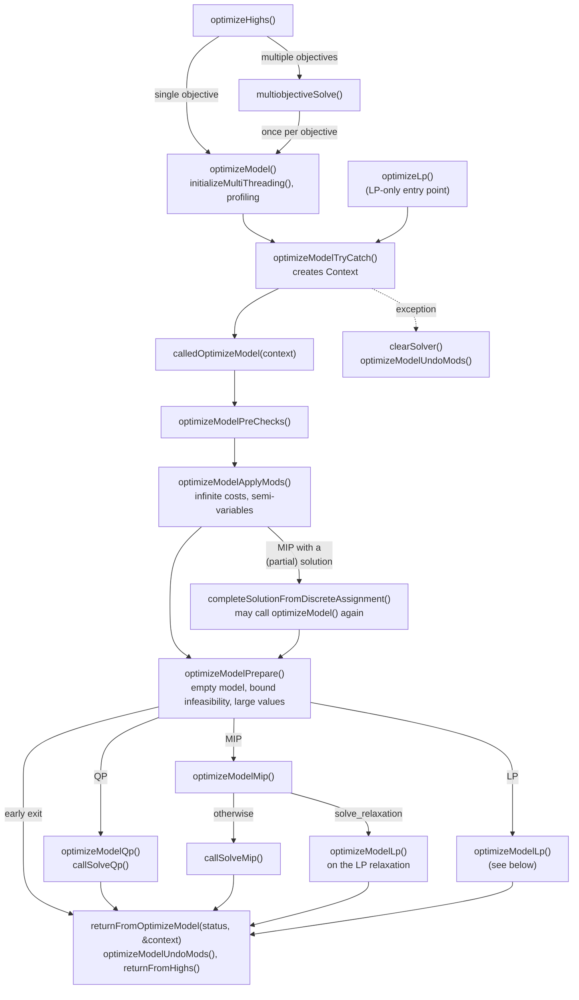
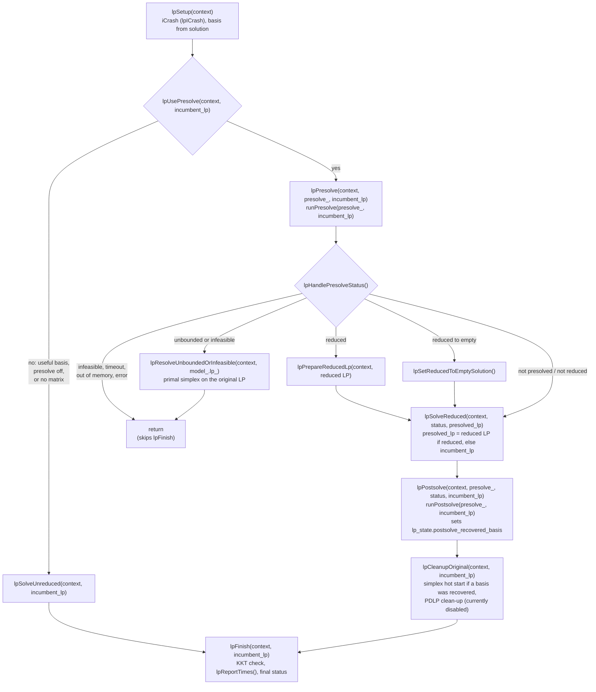

# Logic flow of `Highs::optimizeHighs()`

This describes the call sequence from `Highs::optimizeHighs()`, which
`Highs::run()` calls after any file reading and user scaling, down to
the solvers.

## From `Highs::optimizeHighs()` to the problem type

Early exits from `optimizeModelPreChecks()` and
`optimizeModelApplyMods()` return straight to `optimizeModelTryCatch()`
without calling `returnFromOptimizeModel()`. `optimizeModelApplyMods()`
undoes any mods itself before returning.

Any change to `options_` during the optimization is made through
`context.options_undo`, and anything still recorded there is undone
when the `Context` is destroyed at the end of
`optimizeModelTryCatch()`.

## `optimizeModelLp()`

Each `lp*` function that can stop the solve returns `true` to do so,
with `context.status` set. The driver then returns straight away, so
`lpFinish()` is skipped.

Every LP solve in this pipeline goes through
`lpTimedSolve(context, lp, description, time)`, which calls
`callSolveLp()` and then `solveLp()` to dispatch to simplex, IPX, PDLP
or HiPO.

State shared between the `lp*` functions is held in `context.lp_state`
(`Highs::LpState`).
