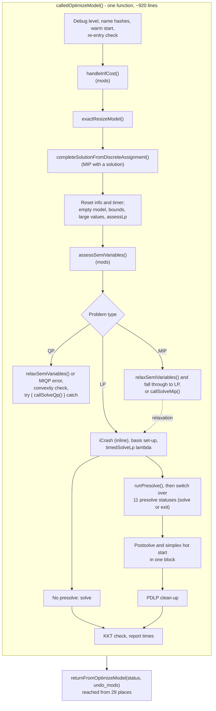
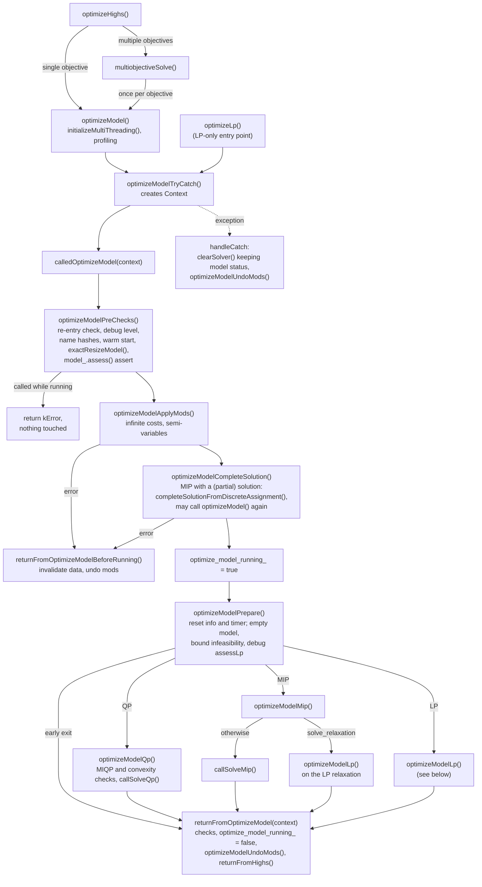
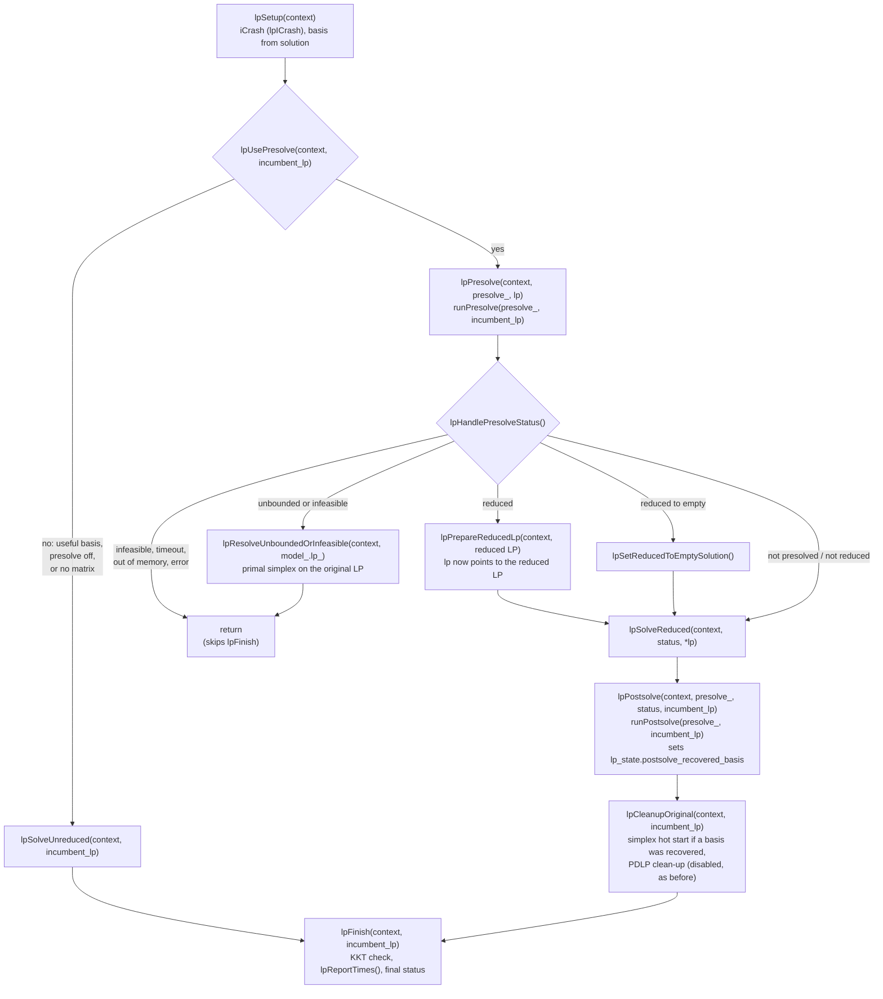

# Refactoring of `Highs::calledOptimizeModel()`

## Summary

- `calledOptimizeModel()` was a single function of about 920 lines,
  with 33 `return` statements. It is now a short driver that calls one
  function per phase. The LP part is a pipeline of `lp*` functions.
- The phases share their state through a `Context` struct, instead of
  through locals.
- Option changes go through a new `HighsUndoStack`, which undoes them
  on every return path, including exceptions. Each function that
  changes options has its own local one, so changes don't outlive the
  function that makes them.
- All modifications ("mods") of the incumbent model are applied in one
  place and undone in one place.
- `runPresolve()` and `runPostsolve()` take the `PresolveComponent`
  and the LP as arguments, so that later LP phases (for example LP
  folding) can run them on an LP other than `model_.lp_`.
- There is now a single exit, `returnFromOptimizeModel(context)`, once
  the solve is marked as running.

Most of the diff is code moved without changes. The behaviour changes
are listed in [Behaviour changes](#behaviour-changes), divided into
fixes and changes in behaviour.

## Files changed

| File | Change |
|---|---|
| `highs/lp_data/Highs.cpp` | Split of `calledOptimizeModel()`, mods, single exit, `runPresolve`/`runPostsolve` overloads, `callRunPostsolve` error path, `run()` unscaling |
| `highs/Highs.h` | `Context`, `LpState`, declarations of the new private methods, flags `optimize_model_running_` and `model_mods_applied_`, overloads |
| `highs/util/HighsUndoStack.h` | New |
| `cmake/sources.cmake` | Lists `util/HighsUndoStack.h` |
| `highs/lp_data/HighsSolve.cpp` | New `SOLVE_CATCH_CALL_MIP`, like `SOLVE_CATCH_CALL`, replacing the inline `try`/`catch` around the MIP solver; `HighsUndoStack` for option changes |
| `highs/lp_data/HighsInterface.cpp` | `HighsUndoStack` for option changes, `has_infinite_cost_` kept up to date in multi-objective solves |
| `highs/simplex/HApp.h` | `HighsUndoStack` for option changes |
| `highs/HighsRun.md` | Describes where the mods are now applied |

## Before



## After: from `optimizeHighs()` to the problem type



Any change to `options_` during the solve is made through a
`HighsUndoStack`: a local one in the function that makes the change,
or `context.options_undo` for a change that must last until the end
of the solve. Anything still recorded in `context.options_undo` is
undone when the `Context` is destroyed at the end of
`optimizeModelTryCatch()`.

## After: `optimizeModelLp()`



Every function that can stop the solve returns `true` to do so, with
`context.status` set, and the caller returns straight away. Every LP
solve goes through `lpTimedSolve()`, which replaces the
`timedSolveLp` lambda.

## New mechanisms

### `Context` and `LpState`

`Highs::Context` is created in `optimizeModelTryCatch()` and passed
down by reference. It holds the status, the timings that used to be
locals, `undo_mods`, `options_undo` (only for option changes that last
the whole solve) and `lp_state`.

`Highs::LpState` holds the values shared by the `lp*` functions: the
debug logging set-up, `solver_will_use_basis`,
`may_require_basis_postsolve`, `no_incumbent_lp_solution_or_basis`,
the pivot threshold from the presolved solve, the PDLP iteration count
of the presolved solve, `postsolve_recovered_basis` and
`presolved_lp_info`.

Two fields are new because postsolve and the simplex hot start were
split: `postsolve_recovered_basis` and `presolved_lp_info`. Both were
locals of the same block before. This split is the only place where
existing code was cut in two, so it deserves the closest look. Nothing
ran between setting the recovered basis and the hot start, and
`LpState` is created fresh for each call, so the flag can't leak from
one solve to the next.

### `HighsUndoStack`

[util/HighsUndoStack.h](util/HighsUndoStack.h) records the old value
of a variable before it is changed, and restores it later. It replaces
saving and restoring values by hand, including copies of the whole
`HighsOptions`:

```cpp
HighsUndoStack options_undo;
options_undo.set(options_.solver, kSimplexString);
...
options_undo.reset();
```

The destructor undoes anything still recorded, so a change is also
undone on early returns and exceptions.

- **Local stacks** are used wherever options are changed and restored
  in the same function: `lpTimedSolve()`, `lpSolveReduced()`,
  `lpCleanupOriginal()` (one each for the debug check, the hot start
  and the PDLP clean-up), `lpResolveUnboundedOrInfeasible()`,
  `completeSolutionFromDiscreteAssignment()`, and in
  `HighsInterface.cpp`, `HighsSolve.cpp` and `simplex/HApp.h`. The
  explicit `reset()` is where the old code restored the values, so the
  order of restores on the normal paths is unchanged.
- **`context.options_undo`** is only for a change that must last until
  the end of the solve. The only one is raising `highs_debug_level` in
  `optimizeModelPreChecks()` (see B10).

The old code sometimes restored a whole copy of `HighsOptions`
(`options_ = save_options`). The new code restores only the fields it
changed. I found no other option written on those paths: the writes in
`HApp.h` and `HEkkDebug.cpp` restore their own values.

### Single exit and `optimize_model_running_`

- The new flag `optimize_model_running_` replaces
  `called_return_from_optimize_model`.
  - It is set after `optimizeModelCompleteSolution()`, which may call
    `optimizeModel()` itself.
  - It is cleared in `returnFromOptimizeModel()` and in `handleCatch`.
  - It is checked first in `optimizeModelPreChecks()`, before
    anything is changed.
- Once the flag is set, the only exit is
  `returnFromOptimizeModel(context)`, which reads the status from the
  context.
- Errors before the flag is set go through
  `returnFromOptimizeModelBeforeRunning()`. It invalidates info, run
  data, solution and basis, sets the model status and undoes the mods.
  The refusal of a call made while a solve is running doesn't use it,
  since that would destroy the running solve's data.
- The assert at the start of `returnFromOptimizeModel()` and the check
  in `returnFromHighs()` are removed, because the single exit makes
  them redundant.

### Mods

- `optimizeModelApplyMods()` makes all changes to the incumbent model:
  infinite costs, and assessing or (with `solve_relaxation`) relaxing
  semi-variables.
- `optimizeModelUndoMods()` undoes them. It is called from
  `returnFromOptimizeModel()`, `returnFromOptimizeModelBeforeRunning()`
  and `handleCatch`.
- The new flag `model_mods_applied_` stops the nested `optimizeModel()`
  call made by `completeSolutionFromDiscreteAssignment()` from applying
  or undoing them a second time.

### Presolve and postsolve on any LP

These overloads are new:

```cpp
runPresolve(PresolveComponent&, HighsLp&, force_lp_presolve, force_presolve)
runPostsolve(PresolveComponent&, const HighsLp&)
```

The old signatures are wrappers that pass `presolve_` and
`model_.lp_`, so `presolve()`, `postsolve()` and the presolve getters
are unchanged. `presolve_log_` and `model_presolve_status_` are only
set when the component is `presolve_`. `model_.isEmpty()` and
`model_.isMip()` became `lp.num_col_ == 0 && lp.num_row_ == 0` and
`lp.isMip()`, which are the same for `model_.lp_`.

## Behaviour changes

### Fixes

| # | Change | Before | After |
|---|---|---|---|
| F1 | MIP primal feasibility tolerance (`solveMip`) | The "restore" assigned the MIP value again, so after any MIP solve the user's `primal_feasibility_tolerance` was left at `mip_feasibility_tolerance` (1e-7 became 1e-6 with defaults), and later LP solves used it | Restored |
| F2 | Infinite costs and a user-supplied MIP solution | If the nested call from `completeSolutionFromDiscreteAssignment()` made semi-variable mods, its undo also ran `restoreInfCost()` on the outer call's record, so the outer MIP was solved with the infinite costs back in place | The nested call leaves mods alone |
| F3 | Exceptions: model status | `handleCatch` set the status, then `clearSolver()` reset it to `kNotset`, so LP and MIP reported `kNotset` (QP had its own catch) | `kMemoryLimit` or `kSolveError` for every problem type |
| F4 | Exceptions: mods | Mods stayed applied to the incumbent model | Undone |
| F5 | Exceptions: re-entry flag | The flag stayed "running", so every later `optimizeModel()` failed (an assert in debug, `kError` in release) | Cleared |
| F6 | Re-entry check | Ran after `clearSolver()` (without warm start) and other changes, so a refused nested call still cleared the running solve's data | Runs first, changes nothing |
| F7 | Early returns that skipped `returnFromOptimizeModel()`: unknown iCrash strategy, `cleanBounds` error | Left the flag stuck and mods applied | Go through the single exit |
| F8 | Failure of `completeSolutionFromDiscreteAssignment()` | Returned without undoing infinite-cost mods | Undone |
| F9 | Errors before the solve runs: infinite costs that can't be handled, invalid semi-variable, failure to complete the solution | `info_.valid` set to `true` over stale info from an earlier solve, run data not invalidated | Info, run data, solution and basis invalidated |
| F10 | `callRunPostsolve()` errors | Called `returnFromOptimizeModel()` outside a solve, which hit its assert in debug | Own clean-up: invalidates info, run data, solution and basis |
| F11 | `Highs::run()` with an error from `optimizeHighs()` | Returned without `userUnscale()`, leaving the model scaled | Unscaled, then the error is returned |
| F12 | Multiple objectives (`multiobjectiveSolve()`, `returnFromLexicographicOptimization()`) | `col_cost_` replaced without updating `has_infinite_cost_`: an assert in debug, or infinite costs reaching the solvers | Flag recomputed whenever the costs change |
| F13 | Option changes in `HApp.h`, `HighsInterface.cpp`, `HighsSolve.cpp` and the LP pipeline | Not restored if an exception was thrown in between | Restored |

### Changes in behaviour

These change results or output in cases that weren't obviously wrong
before.

| # | Change | Effect |
|---|---|---|
| B1 | **Order of mods.** Semi-variables are assessed (or relaxed) together with the infinite-cost handling, before `completeSolutionFromDiscreteAssignment()`. Before, only infinite costs came first. This is what makes F2 possible. | The completion step sees the assessed bounds and types: (a) a semi-continuous variable with lower bound 0 is now continuous, so the user's value for it is no longer fixed; (b) a semi-variable with inconsistent bounds is fixed at 0, so a non-zero user value makes the user's solution infeasible; (c) an upper bound above `kMaxSemiVariableUpper` has been tightened (or the lower bound relaxed with `solve_relaxation`) before the feasibility check. The completed solution, which is the MIP solver's starting point, can differ from before. The model solved by the MIP solver is unchanged. |
| B2 | **Order of checks.** Semi-variable assessment now runs before the empty-model, bound-infeasibility and `assessLp` checks. | A model with both an invalid semi-variable and one of those problems now gets the semi-variable error (`kSolveError`). `processedBoundsFindsInfeasibility()` now sees assessed bounds. I found no case where its result changes. |
| B3 | **Invalid semi-variable error** returns before the solve runs (follows from B2). | It goes through `returnFromOptimizeModelBeforeRunning()`, not `returnFromOptimizeModel()`, so there are no debug checks, no `reportSolvedLpQpStats()` and no `returnFromHighs()`. The status is still `kError` with `kSolveError`. |
| B4 | **Failure to complete a MIP solution** now invalidates the solution (F9). | The user's partial solution is dropped on this error. The model status left by the nested call is kept. |
| B5 | **QP exceptions** are handled by the single catch in `optimizeModelTryCatch()`, not by a catch around `callSolveQp()`. | `clearSolver()` instead of `returnFromOptimizeModel()`: no debug checks, no stats report, no `returnFromHighs()`. The status is the same (`kMemoryLimit` or `kSolveError`). Exceptions thrown inside the solvers themselves are still caught by `SOLVE_CATCH_CALL` in `HighsSolve.cpp`. |
| B6 | **`callRunPostsolve()` errors** (F10). | No `reportSolvedLpQpStats()` output. Info, solution and basis are always invalidated. Before, that only happened if the model status was an error status. |
| B7 | **Re-entry refusal** logs a user error instead of a developer error and an assert. | Visible in the log. |
| B8 | **`run_data_.valid`** in `Highs::run()` is set after unscaling. | Stays `false` if `userUnscale()` returns an error. Before, it was `true`. |
| B9 | **`assessLp` warning** in `optimizeModelPrepare()` no longer reaches the QP/MIP status. | None in practice: it is asserted never to happen, and the assert in `returnFromOptimizeModel()` rejected it anyway. |
| B10 | **Raised `highs_debug_level`** is undone at the end of the solve. | None in practice: it only applies when the option is below its minimum, which option checks prevent. |

## Other points for the review

- **Public API.** `HighsStatus calledOptimizeModel();` was in the
  public section of `Highs` (under "advanced methods: only for internal
  use"). It is now private and takes a `Context&`. Nothing in the
  repository calls it.
- **Installed header.** `Highs.h` now includes `util/HighsUndoStack.h`,
  so the new header has to be installed with it. It is listed in
  `cmake/sources.cmake`. `highs/meson.build` lists no headers, so
  nothing is needed there.
- **Unchanged dead code.** The PDLP clean-up in `lpCleanupOriginal()`
  is still disabled by `consider_pdlp_cleanup = false`, and
  `possibly_use_log_dev_level_2` is still `false`. Both were moved
  without change.
- **Not in scope.** The bound changes in
  `processedBoundsFindsInfeasibility()` are still permanent changes to
  the incumbent model rather than mods. This is listed as an
  observation in [HighsRun.md](HighsRun.md).

## Where each part went

These are moves. Apart from the items listed under
[Behaviour changes](#behaviour-changes), the only edits are locals
becoming `Context`/`LpState` fields, `return
returnFromOptimizeModel(...)` becoming `return true`, and manual
option save/restore becoming `HighsUndoStack`.

| Old part of `calledOptimizeModel()` | Now |
|---|---|
| Re-entry check, debug level, name hashes, warm start, `exactResizeModel()`, `model_.assess()` assert (added in `latest`, moved here so that it checks the model before any mods) | `optimizeModelPreChecks()` |
| `handleInfCost()`, `assessSemiVariables()`, `relaxSemiVariables()` (in the QP and MIP branches) | `optimizeModelApplyMods()`, undone by `optimizeModelUndoMods()` |
| Call of `completeSolutionFromDiscreteAssignment()` | `optimizeModelCompleteSolution()` |
| Reset info and timer, empty model, bounds, `assessLp` (the large-value check was removed in `latest`, which checks the model with `model_.assess()` in `run()`) | `optimizeModelPrepare()` |
| QP branch | `optimizeModelQp()` |
| MIP branch | `optimizeModelMip()` |
| Debug log level set-up, basis set-up | `lpSetup()` |
| iCrash (inline) | `lpICrash()`, called from `lpSetup()` |
| `timedSolveLp` lambda | `lpTimedSolve()` |
| Choice of whether to presolve | `lpUsePresolve()` |
| Solve without presolve | `lpSolveUnreduced()` |
| `runPresolve()` and reduction reporting | `lpPresolve()` |
| Terminal presolve statuses | `lpHandlePresolveStatus()`, with `lpResolveUnboundedOrInfeasible()` |
| Assess and `cleanBounds` on the reduced LP | `lpPrepareReducedLp()` |
| Trivial solution when reduced to empty | `lpSetReducedToEmptySolution()` |
| Solves in the presolve switch | `lpSolveReduced()` |
| Postsolve | `lpPostsolve()` |
| Simplex hot start after postsolve, PDLP clean-up | `lpCleanupOriginal()` |
| KKT check, info, final status | `lpFinish()` |
| Report times | `lpReportTimes()` |

Dead code removed:

- the `use_highs_crossover` branch in iCrash (constant `false`)
- the commented-out save and restore of `log_dev_level` in
  `solveMip()`
