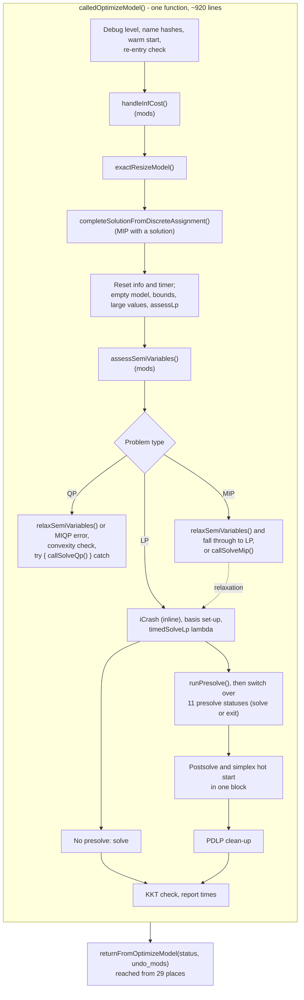
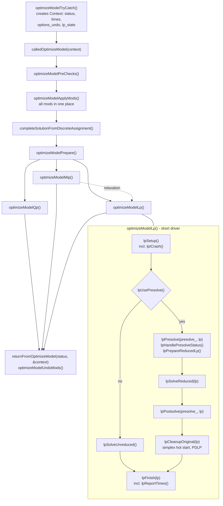

# Refactoring of `Highs::calledOptimizeModel()`

This note summarises the refactoring in commits `bef41ba235` ("Separate
ICrash") to `ae9ed48dfe` ("Shorten names"). For the current call flow
in detail, see [OptimizeModelFlowDiagram.md](OptimizeModelFlowDiagram.md).

## Why

`Highs::calledOptimizeModel()` was a single function of about 920
lines. It handled model checks, "mods", QP, MIP and the whole LP path
(iCrash, presolve, solve, postsolve, clean-up), and had 33 `return`
statements. Option values were changed and restored by hand at each
point where they were needed.

The aim is to make the stages separate functions that take the LP they
work on as an argument. This makes it possible to insert new stages
later, in particular LP folding, after some simple presolve rules
have run but before full presolve.

Results should be unchanged. The few behaviour changes are fixes, and
are listed [below](#behaviour-changes).

## Before



## After



Each function that can end the solve returns `true` to do so, with
`context.status` set, so the caller just returns.

## Where each part went

| Old part of `calledOptimizeModel()` | Now |
|---|---|
| Debug level, name hashes, warm start, re-entry check, `exactResizeModel()` | `optimizeModelPreChecks()` |
| `handleInfCost()`, `assessSemiVariables()`, `relaxSemiVariables()` (in the QP and MIP branches) | `optimizeModelApplyMods()`, undone by `optimizeModelUndoMods()` |
| Reset info and timer, empty model, bounds, large values, `assessLp` | `optimizeModelPrepare()` |
| QP branch | `optimizeModelQp()` |
| MIP branch | `optimizeModelMip()` |
| iCrash (inline) | `lpICrash()`, called from `lpSetup()` |
| Basis set-up, debug log level | `lpSetup()` |
| `timedSolveLp` lambda | `lpTimedSolve()` |
| Choice of whether to presolve | `lpUsePresolve()` |
| Solve without presolve | `lpSolveUnreduced()` |
| `runPresolve()` and reduction reporting | `lpPresolve()` |
| Terminal presolve statuses | `lpHandlePresolveStatus()`, with `lpResolveUnboundedOrInfeasible()` |
| Assess and `cleanBounds` on the reduced LP | `lpPrepareReducedLp()` |
| Trivial solution when reduced to empty | `lpSetReducedToEmptySolution()` |
| Solve after presolve | `lpSolveReduced()` |
| Postsolve | `lpPostsolve()` |
| Simplex hot start after postsolve, PDLP clean-up | `lpCleanupOriginal()` |
| KKT check, info, final status | `lpFinish()` |
| Report times | `lpReportTimes()` |

## Other changes

### `Context`

`Highs::Context` is created in `optimizeModelTryCatch()` and passed
down by reference. It holds:

- the status and the timings that used to be locals
- `undo_mods`
- `options_undo` (see next section)
- `lp_state` (`Highs::LpState`): values shared between the `lp*`
  functions, such as whether the solver will use a basis, the pivot
  threshold from the presolved solve, and whether postsolve recovered
  a basis

### Changing options: `HighsUndoStack`

The new class [HighsUndoStack](util/HighsUndoStack.h) replaces saving
and restoring option values by hand (including copies of the whole
`HighsOptions`):

```cpp
const size_t mark = context.options_undo.mark();
context.options_undo.set(options_.solver, kSimplexString);
...
context.options_undo.resetTo(mark);
```

Anything still recorded is undone when the `Context` is destroyed,
including on early returns and exceptions. The same pattern now
replaces manual save and restore in `HighsInterface.cpp`,
`HighsSolve.cpp` and `simplex/HApp.h`.

### Mods

All modifications of the incumbent model (infinite costs and
semi-variables) are made in `optimizeModelApplyMods()` and undone in
`optimizeModelUndoMods()`. The undo is called from
`returnFromOptimizeModel()`, or directly on the early exits and in the
exception handler. The new flag `model_mods_applied_` stops a nested
`optimizeModel()` call from `completeSolutionFromDiscreteAssignment()`
from applying or undoing them again.

### Presolve and postsolve on any LP

`runPresolve()` and `runPostsolve()` now have overloads that take the
`PresolveComponent` and the LP explicitly. The old signatures remain
as wrappers that pass `presolve_` and `model_.lp_`, so `presolve()`,
`postsolve()` and the presolve getters are unchanged.

## Behaviour changes

The last three are fixes. The first is what makes the second possible,
and it changes what `completeSolutionFromDiscreteAssignment()` sees.

- **Order of mods.** Semi-variables are now assessed (or, with
  `solve_relaxation`, relaxed) before
  `completeSolutionFromDiscreteAssignment()` runs, together with the
  infinite-cost handling. Previously only the infinite costs were
  handled first: semi-variables were assessed after it, and the nested
  `optimizeModel()` call it makes assessed them itself and undid that
  on return. Now they are assessed once, the nested call leaves the
  mods alone, and an invalid semi-variable gives an error before the
  nested solve rather than after it.

  `completeSolutionFromDiscreteAssignment()` fixes every non-continuous
  variable at the user's value, checks the user's solution against the
  bounds, and solves for the rest. It now sees semi-variables after
  assessment, so:

  - A semi-continuous variable with a zero lower bound has become
    continuous, so the user's value for it is no longer fixed: the
    nested solve chooses it. (A semi-integer variable with a zero lower
    bound becomes integer, so its value is still fixed.)
  - A semi-variable with inconsistent bounds has been fixed at zero, so
    a non-zero user value for it makes the user's solution infeasible.
  - An upper bound above `kMaxSemiVariableUpper` has been tightened to
    it (or, with `solve_relaxation`, the lower bound relaxed to zero),
    so the feasibility check uses the modified bound.

  In these cases the completed solution, which is used as the MIP
  solver's starting point, can differ from before. The model solved by
  the MIP solver is unchanged.

- **Infinite costs with a user-supplied MIP solution.** All mods are
  recorded in the single `lp.mods_`, and `unapplyMods()` undoes and
  clears all of it. Previously, if the nested `optimizeModel()` called
  from `completeSolutionFromDiscreteAssignment()` made semi-variable
  mods, its undo also ran `restoreInfCost()` on the outer call's
  infinite-cost record. That put the infinite costs back on the
  incumbent (and set `has_infinite_cost_`) before the outer MIP was
  solved, and left the outer call nothing to undo. This needed infinite
  costs, a user-supplied solution and an unfixed semi-variable that
  assessment changes. Now `model_mods_applied_` stops the nested call
  from applying or undoing any mods, so the outer solve always runs
  with the infinite costs handled.

- **Exceptions.** `callSolveQp()` no longer has its own `try/catch`.
  Exceptions from LP, MIP and QP are all handled by the one in
  `optimizeModelTryCatch()`, which clears the solver data and undoes
  the mods. That handler used to lose the model status it had just set,
  because `clearSolver()` resets it to `kNotset`. It now keeps it, so
  after an exception `getModelStatus()` returns `kMemoryLimit` (out of
  memory) or `kSolveError` (anything else) for every problem type.
  Previously this was true for QP only, and LP and MIP returned
  `kNotset`.

- **Multiple objectives.** `multiobjectiveSolve()` replaces
  `col_cost_` directly, which left `has_infinite_cost_` stale. With
  infinite costs in the incumbent but not in an objective, debug
  builds hit an assert; with infinite costs in an objective but not in
  the incumbent, the costs reached the solvers unhandled. The flag is
  now recomputed whenever the costs change, so an objective's infinite
  costs are handled as in a single-objective solve, including the same
  error when they cannot be.
